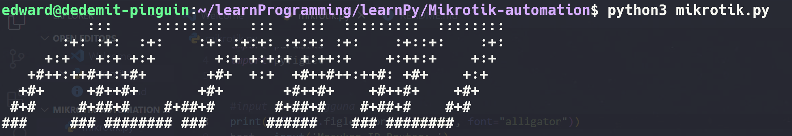

# 🛜 ACMRO: Auto Config MikroTik RouterOS

Skrip Python interaktif untuk mengonfigurasi router **MikroTik** lewat **SSH**. Konfigurasi dasar seperti IP address, DHCP client, dan NAT masquerade cukup dipilih dari menu, tanpa membuka Winbox atau mengetik perintah RouterOS satu per satu.




---

## ✨ Fitur

| Menu | Fungsi                    | Perintah RouterOS yang dijalankan                                      |
| ---- | ------------------------- | ---------------------------------------------------------------------- |
| 1    | Tambah IP address         | `/ip/address/add address=<ip> interface=ether<n>`                      |
| 2    | Tambah DHCP client        | `/ip/dhcp-client/add interface=ether<n>`                               |
| 3    | NAT masquerade (internet) | `/ip/firewall/nat/add chain=srcnat out-interface=ether<n> action=masquerade` |
| 4    | Lihat daftar IP address   | `/ip/address/print`                                                    |
| 0    | Keluar                    | Menutup koneksi SSH                                                    |

- Setelah perintah dijalankan, hasilnya langsung ditampilkan, termasuk pesan error dari router.
- Satu koneksi SSH dipakai untuk semua menu sampai kamu memilih keluar.
- Password tidak tampil di layar saat diketik.

---

## 📋 Prasyarat

- Python 3.8 atau lebih baru
- Router MikroTik dengan **RouterOS v7** (perintah memakai format path `/ip/address/...`)
- Layanan SSH aktif di router (**IP → Services → ssh**) dan bisa dijangkau dari komputer kamu
- Akun router dengan hak akses `write` atau `full`

---

## 🚀 Instalasi

```bash
git clone https://github.com/MbahPinguinSakti/Mikrotik-automation.git
cd Mikrotik-automation

python3 -m venv .venv
source .venv/bin/activate          # bash / zsh
# source .venv/bin/activate.fish   # fish
# .venv\Scripts\activate           # Windows

pip install -r requirements.txt
```

---

## ▶️ Cara pakai

```bash
python3 mikrotik.py
```

Masukkan IP router, username, dan password, lalu pilih menu. Untuk interface, cukup ketik nomornya (`1` untuk `ether1`) atau nama lengkapnya (`ether1`).

### Contoh: router mendapat internet dari ether1, LAN di ether2

```plaintext
Masukan IP Router: 192.168.56.1
Masukan Username: admin
Masukan Password:

pilih salah satu atau ketik 0 untuk mengakhiri: 2
Mau ether berapa? (1/2/3): 1

pilih salah satu atau ketik 0 untuk mengakhiri: 1
Masukan IP Address (contoh 192.168.56.100/24): 192.168.10.1/24
Masukan nomor interface (1/2/3): 2

pilih salah satu atau ketik 0 untuk mengakhiri: 3
out interface (1/2/3)?: 1

pilih salah satu atau ketik 0 untuk mengakhiri: 0
done
```

---

## ⚠️ Catatan keamanan

- Skrip menerima host key router secara otomatis (`AutoAddPolicy`). Ini praktis untuk lab, tapi sebaiknya hanya dipakai di jaringan yang kamu percaya.
- Perintah langsung dijalankan di router. Coba dulu di lab atau CHR/GNS3 sebelum dipakai di router produksi.

---

## 📜 Lisensi

Proyek ini belum memiliki lisensi. Tanpa lisensi, hak cipta tetap pada pemilik repositori.
